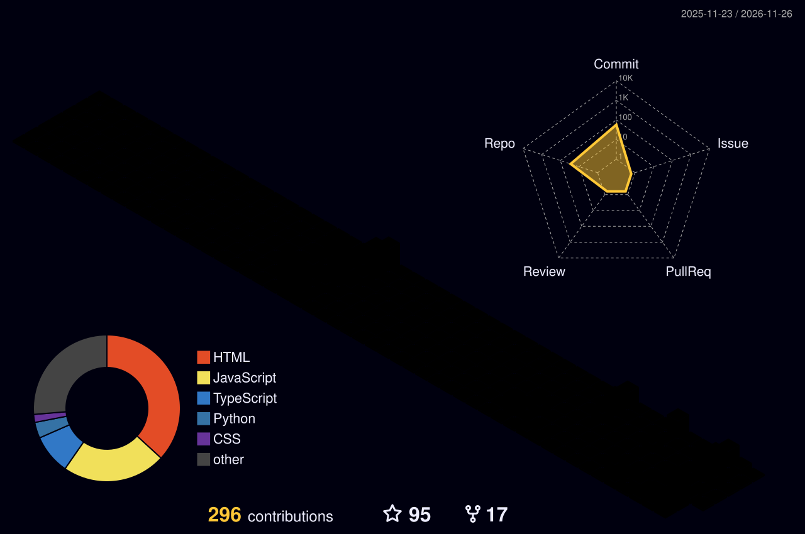

<div align="center">

<!-- HERO BANNER -->


<!-- TYPING SUBTITLE -->
<a href="https://github.com/laluariftrasnaashari">
  
</a>

<!-- LOCATION & STATUS PILLS -->
<p>
  
  
  
</p>

<!-- SOCIAL & CONTACT LINKS -->
<p>
  <a href="https://www.linkedin.com/in/laluariftrasnaashari/"></a>
  <a href="mailto:gawahkocak@gmail.com"></a>
  <a href="https://www.youtube.com/@laluariftrasnaashari4794/videos"></a>
  <a href="https://www.dicoding.com/users/laluarifta/academies"></a>
</p>

<br>

<!-- SECTION NAVIGATION -->
<p>
  <a href="#-tentang-saya"></a>
  <a href="#-fokus-kerja"></a>
  <a href="#-teknologi--perangkat"></a>
  <a href="#-pengalaman--kepemimpinan"></a>
  <a href="#-pelatihan--sertifikasi"></a>
  <a href="#-kontribusi-github"></a>
</p>

</div>

---

## 👨‍💻 Tentang saya

Lulusan **Ilmu Komputer (S.Kom), Universitas Bumigora**, dengan fokus pada administrasi jaringan, Linux, dan operasional teknologi informasi. Berpengalaman dalam pengembangan perangkat lunak, pengajaran, serta penyusunan kurikulum komunitas teknologi.

<!-- BENTO GRID: OVERVIEW & YAML CONFIG -->
<table>
  <tr>
    <td width="50%" valign="top">
      <b>📌 Ringkasan Aktivitas</b>
      <br><br>
      <table>
        <tr>
          <td><b>Saat ini</b></td>
          <td>Asisten Teknologi Informasi di <b>BPR NTB</b></td>
        </tr>
        <tr>
          <td><b>Sedang mendalami</b></td>
          <td>DevOps, Kubernetes, Red Hat OpenShift</td>
        </tr>
        <tr>
          <td><b>Terbuka untuk diskusi</b></td>
          <td>Networking, cybersecurity, Red Hat Linux, web development</td>
        </tr>
        <tr>
          <td><b>Domisili</b></td>
          <td>Mataram, Nusa Tenggara Barat, Indonesia</td>
        </tr>
      </table>
    </td>
    <td width="50%" valign="top">
      <b>🖥️ System Spec (<code>profile.yml</code>)</b>
      <br><br>

```yaml
engineer:
  name: Lalu Arif Trasna Ashari
  degree: S.Kom (Universitas Bumigora)
  current_role: IT Assistant @ BPR NTB
  domains:
    - Network Administration
    - Linux & IT Operations
    - Infrastructure Automation
  exploring:
    - Kubernetes & Red Hat OpenShift
    - CI/CD & DevOps Practices
```

    </td>
  </tr>
</table>

---

## 🎯 Fokus kerja

<table>
  <tr>
    <td align="center" width="33%" valign="top">
      <br>
      
      <br><br>
      <b>Reliability & Infrastructure</b><br>
      Menjaga layanan, jaringan, dan sistem tetap andal dengan pemantauan dan operasional yang terstruktur.
      <br><br>
    </td>
    <td align="center" width="33%" valign="top">
      <br>
      
      <br><br>
      <b>Efficiency & Scripting</b><br>
      Menyederhanakan pekerjaan berulang dan pengelolaan konfigurasi sistem dengan otomasi.
      <br><br>
    </td>
    <td align="center" width="33%" valign="top">
      <br>
      
      <br><br>
      <b>Mentorship & Curriculum</b><br>
      Membagikan pengetahuan melalui pengajaran langsung dan penyusunan kurikulum komunitas teknologi.
      <br><br>
    </td>
  </tr>
</table>

---

## 🛠️ Teknologi & perangkat

<table>
  <thead>
    <tr>
      <th align="left" width="28%">Area</th>
      <th align="left" width="72%">Teknologi & Perangkat</th>
    </tr>
  </thead>
  <tbody>
    <tr>
      <td><b>Jaringan & Sistem Operasi</b></td>
      <td>
        
        
        
        
      </td>
    </tr>
    <tr>
      <td><b>Otomasi & DevOps</b></td>
      <td>
        
        
        
        
        
        
      </td>
    </tr>
    <tr>
      <td><b>Pengembangan Aplikasi</b></td>
      <td>
        
        
        
        
        
        
        
        
      </td>
    </tr>
    <tr>
      <td><b>Database & Tools</b></td>
      <td>
        
        
        
        
        
        
      </td>
    </tr>
  </tbody>
</table>

---

## 💼 Pengalaman & kepemimpinan

| Peran | Organisasi | Periode | Fokus |
| :--- | :--- | :--- | :--- |
| **Asisten Teknologi Informasi** | **BPR NTB** | `Agu 2026 – sekarang` | Operasional TI dan sistem perbankan |
| **Curriculum Leader** | **UKM Programming Community & NetCom** | `Jan 2022 – Feb 2025` | Java, Dart, networking, dan kepemimpinan |
| **Teacher** | **Kampus Mengajar Angkatan 7** | `Des 2023 – Jun 2024` | Pengajaran dan pemetaan kurikulum |
| **Network Administrator** | **Universitas Negeri Surabaya** | `Sep 2023 – Des 2023` | Administrasi jaringan dan IT support |

---

## 🎓 Pelatihan & sertifikasi

| Sertifikasi | Penerbit | Periode |
| :--- | :--- | :--- |
| **Red Hat OpenShift Administration I (DO180)** |  | `Jul 2025` |
| **Red Hat Enterprise Linux Automation with Ansible (RH294)** |  | `Nov 2024` |
| **Network Automation with Red Hat Ansible (DO457)** |  | `—` |
| **Basic Teller & Admin Operations** |  | `Agu 2026` |
| **Belajar Dasar-Dasar DevOps & Jaringan Komputer** |  | `—` |

---

## ⚙️ Cara saya bekerja

<table>
  <tr>
    <td width="33%" valign="top">
      <br><br>
      <b>Kebutuhan Sebelum Teknologi</b><br>
      Memahami kebutuhan operasional secara menyeluruh sebelum memilih arsitektur atau teknologi yang digunakan.
    </td>
    <td width="33%" valign="top">
      <br><br>
      <b>Sederhana & Terdokumentasi</b><br>
      Mengutamakan solusi yang sederhana, terdokumentasi dengan rapi, dan mudah dirawat dalam jangka panjang.
    </td>
    <td width="33%" valign="top">
      <br><br>
      <b>Belajar Melalui Praktik</b><br>
      Mengasah pemahaman teknis secara langsung pada Linux, jaringan, otomasi, dan pengembangan aplikasi.
    </td>
  </tr>
</table>

---

## 📊 Kontribusi GitHub

<div align="center">
  
</div>

---

<div align="center">

### 🤝 Mari terhubung

Untuk diskusi teknologi atau peluang kolaborasi, hubungi saya melalui [LinkedIn](https://www.linkedin.com/in/laluariftrasnaashari/), [email](mailto:gawahkocak@gmail.com), atau lihat profil belajar saya di [Dicoding](https://www.dicoding.com/users/laluarifta/academies).

Konten video tersedia di [YouTube](https://www.youtube.com/@laluariftrasnaashari4794/videos).

<br>

<p>
  <a href="https://www.linkedin.com/in/laluariftrasnaashari/"></a>
  <a href="mailto:gawahkocak@gmail.com"></a>
  <a href="https://www.youtube.com/@laluariftrasnaashari4794/videos"></a>
  <a href="https://www.dicoding.com/users/laluarifta/academies"></a>
</p>

<!-- FOOTER WAVE -->


</div>
