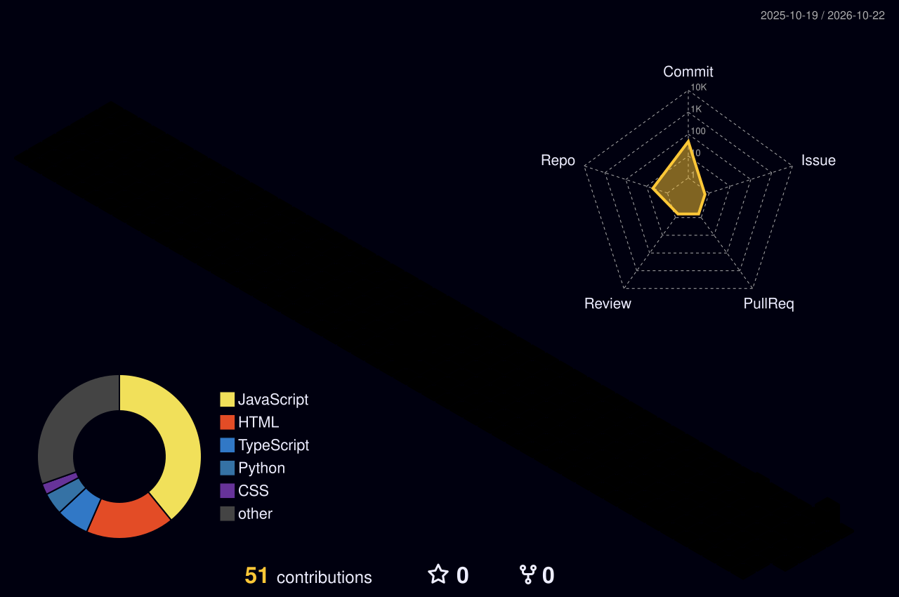

# Lalu Arif Trasna Ashari

**Network Engineer · IT Operations · Linux & Automation**

Mataram, Nusa Tenggara Barat, Indonesia

  
  
  
  

---

## Tentang saya

Lulusan **Ilmu Komputer (S.Kom), Universitas Bumigora**, dengan fokus pada administrasi jaringan, Linux, dan operasional teknologi informasi. Berpengalaman dalam pengembangan perangkat lunak, pengajaran, serta penyusunan kurikulum komunitas teknologi.

| | |
| :--- | :--- |
| **Saat ini** | Asisten Teknologi Informasi di **BPR NTB** |
| **Sedang mendalami** | DevOps, Kubernetes, Red Hat OpenShift |
| **Terbuka untuk diskusi** | Networking, cybersecurity, Red Hat Linux, web development |

### Fokus kerja

<table>
  <tr>
    <td align="center" width="33%">
        
      Menjaga layanan, jaringan, dan sistem tetap andal.
    </td>
    <td align="center" width="33%">
        
      Menyederhanakan pekerjaan berulang dengan otomasi.
    </td>
    <td align="center" width="33%">
        
      Membagikan pengetahuan melalui pengajaran dan kurikulum.
    </td>
  </tr>
</table>
## Teknologi & perangkat

| Area | Teknologi |
| :--- | :--- |
| **Jaringan & sistem operasi** |   |
| **Otomasi & DevOps** |       |
| **Pengembangan aplikasi** |         |
| **Database & tools** |       |

Tools lain: **9Router** dan **OmniRouter**.

---

## Pengalaman & kepemimpinan

| Peran | Organisasi | Periode | Fokus |
| :--- | :--- | :--- | :--- |
| **Asisten Teknologi Informasi** | BPR NTB | Agu 2026 – sekarang | Operasional TI dan sistem perbankan |
| **Curriculum Leader** | UKM Programming Community & NetCom | Jan 2022 – Feb 2025 | Java, Dart, networking, dan kepemimpinan |
| **Teacher** | Kampus Mengajar Angkatan 7 | Des 2023 – Jun 2024 | Pengajaran dan pemetaan kurikulum |
| **Network Administrator** | Universitas Negeri Surabaya | Sep 2023 – Des 2023 | Administrasi jaringan dan IT support |

---

## Pelatihan & sertifikasi

| Sertifikasi | Penerbit | Periode |
| :--- | :--- | :--- |
| Red Hat OpenShift Administration I (DO180) | Red Hat | Jul 2025 |
| Red Hat Enterprise Linux Automation with Ansible (RH294) | Red Hat | Nov 2024 |
| Network Automation with Red Hat Ansible (DO457) | Red Hat | — |
| Basic Teller & Admin Operations | PT BPR NTB PERSERODA | Agu 2026 |
| Belajar Dasar-Dasar DevOps & Jaringan Komputer | Dicoding Indonesia | — |

---

## Kontribusi GitHub

  

---

## Cara saya bekerja

- Memahami kebutuhan operasional sebelum memilih teknologi.
- Mengutamakan solusi yang sederhana, terdokumentasi, dan mudah dirawat.
- Belajar melalui praktik: Linux, jaringan, otomasi, dan pengembangan aplikasi.

---

### Mari terhubung

Untuk diskusi teknologi atau peluang kolaborasi, hubungi saya melalui [LinkedIn](https://www.linkedin.com/in/laluariftrasnaashari/), [email](mailto:gawahkocak@gmail.com), atau lihat profil belajar saya di [Dicoding](https://www.dicoding.com/users/laluarifta/academies).

Konten video tersedia di [YouTube](https://www.youtube.com/@laluariftrasnaashari4794/videos).

